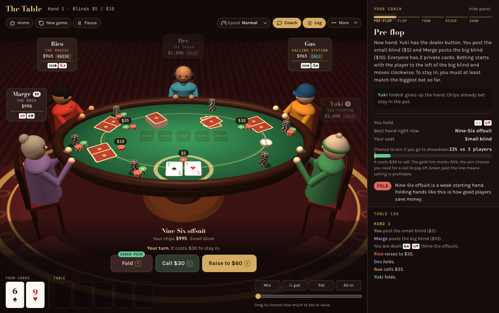

# My Wise Bet

A free, educational casino in the browser. Sit at a 3D table, play classic casino games against computer players, and learn from an AI coach that explains the odds and the reasoning behind every decision, and answers any question you ask.

**Practice only:** chips are pretend, nothing can be bought or won, and no real money is ever involved.

**Play it at [mywisebet.com](https://mywisebet.com).**



## Games

| Game            | What you learn                                                   |
| --------------- | ---------------------------------------------------------------- |
| Texas Hold'em   | Hand rankings, pot odds, position and reading opponents          |
| Blackjack       | Basic strategy, bust odds, and when to hit, stand, double, split |
| Roulette        | Where the house edge comes from, and why betting systems fail    |
| Craps           | The pass line and free odds versus the sucker bets in the middle |
| Baccarat        | Why Banker is the best bet, and why scorecards predict nothing   |

More games are on the way.

## How it teaches

- **A coach on every turn:** your odds, the move it would make, and why, in plain words.
- **Ask anything:** a free AI chat that sees the game in front of you. No sign-up.
- **Opponents with personalities:** computer players with their own styles, moods and tells. X-ray mode shows their cards and reasoning.
- **The honest math:** see where the house edge comes from, and why good decisions beat lucky ones.
- **Learn at your pace:** pause anywhere, change the speed, skip ahead and replay the table. Works on phones too.

## Project layout

```
index.html          markup
css/style.css       styles
js/poker.js         poker hand evaluation and equity (pure functions)
js/app.js           3D room, shared UI and coach, Hold'em engine and bots
js/blackjack.js     blackjack
js/tables.js        shared engine for dealer games where everyone bets on one outcome
js/roulette.js      roulette, js/craps.js craps, js/baccarat.js baccarat
worker/             Cloudflare Worker behind the AI chat
```

No build step and no dependencies beyond Three.js from a CDN. Each game reuses the shared room, labels, action bar and coach panel, so adding a new game mostly means writing its rules and coach advice.

## Develop

```sh
npm run dev       # serve the site locally
npm run format    # prettier
```

## The AI chat

`worker/` is a small Cloudflare Worker. It:

- keeps a [Groq](https://console.groq.com) key secret
- adds the coach's instructions
- answers only this site
- rate-limits each visitor
- streams the reply back as plain text

Both services' free tiers cover a small audience.

```sh
cd worker
npx wrangler login
npx wrangler secret put GROQ_API_KEY
npx wrangler deploy
```

Then set `COACH_URL` in `js/app.js` to the Worker's URL.

## Contributing

Pull requests are welcome, including new games. See [CONTRIBUTING.md](CONTRIBUTING.md).

## License

MIT
